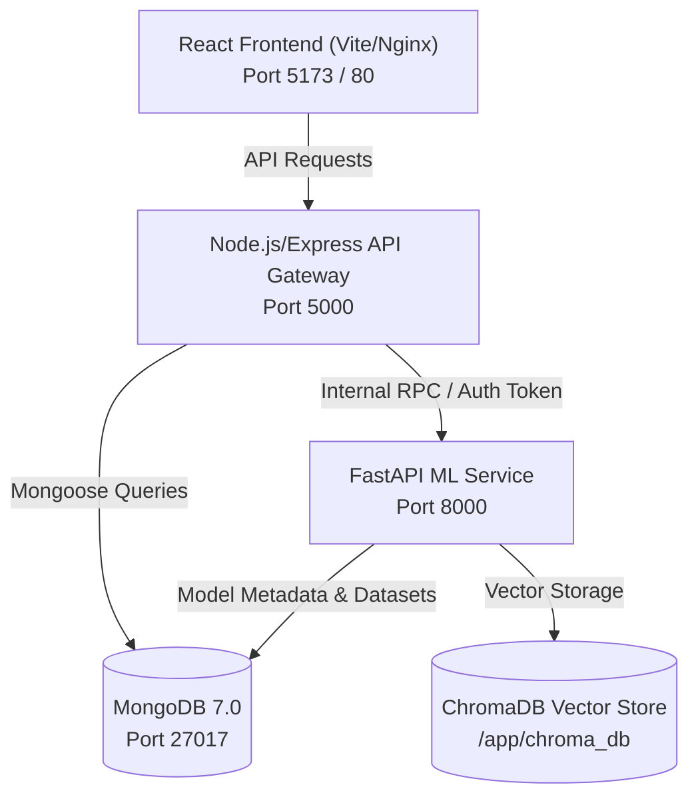

# RetentionAI — Deployment, Orchestration & Validation Guide

**Version:** 1.0.0  
**Target Environments:** Local Development, Docker Compose, Staging, and Production Multi-Tenant Cloud

---

## 1. System Architecture & Container Topology

RetentionAI is deployed as a microservices architecture consisting of four core containerized services connected over an isolated Docker bridge network (`retentionai`):



### 1.1 Service Specifications

| Service | Technology | Port | Persistent Volumes | Healthcheck Command |
|---|---|---|---|---|
| **`mongo`** | MongoDB 7.0 | `27017` | `mongo_data:/data/db` | `mongosh --eval "db.adminCommand('ping')"` |
| **`ai-service`** | Python 3.11 / FastAPI | `8000` | `model_data:/app/models/active`<br/>`chroma_data:/app/chroma_db`<br/>`knowledge_base_data:/app/knowledge_base` | `curl -fsS http://127.0.0.1:8000/health` |
| **`server`** | Node.js 20 / Express | `5000` | `uploads_data:/app/uploads` | `node -e "fetch('http://127.0.0.1:5000/health').then(r=>process.exit(r.ok?0:1))"` |
| **`client`** | React 18 / Vite / Nginx | `5173` | None (Stateless static SPA) | `wget --no-verbose --tries=1 --spider http://127.0.0.1:80/` |

---

## 2. Environment Variables & Secret Configuration

Copy `.env.example` to `.env` in the root and configure mandatory secrets:

```bash
# ==============================================================================
# Database Configuration
# ==============================================================================
MONGODB_URI=mongodb://mongo:27017
MONGODB_DB_NAME=retentionai

# ==============================================================================
# Security & Cryptographic Tokens
# ==============================================================================
JWT_ACCESS_SECRET=your-min-32-char-random-jwt-access-secret-key-here
JWT_REFRESH_SECRET=your-min-32-char-random-jwt-refresh-secret-key-here
AI_SERVICE_TOKEN=your-random-internal-ai-service-bearer-token-here
HMAC_TELEMETRY_SECRET=your-min-32-char-hmac-telemetry-pseudonymization-key
REQUIRE_MANIFEST_CHECKSUM=true

# ==============================================================================
# AI Service & Model Paths
# ==============================================================================
AI_SERVICE_URL=http://ai-service:8000
MODEL_ARTIFACT_PATH=../models/active
CHROMA_PERSIST_DIRECTORY=./chroma_db
AI_MODELS_OFFLINE=true
GROQ_API_KEY=your-optional-groq-api-key-here
```

---

## 3. Automated CI/CD Pipeline

The GitHub Actions workflow (`.github/workflows/ci.yml`) runs on all pushes and pull requests to `main`, `master`, and `develop`:

1. **`backend-tests` (Ubuntu 22.04, Node 20):**
   - Installs server dependencies via `npm ci`.
   - Verifies backend syntax with `node --check src/app.js`.
   - Runs unit and Supertest integration tests via `npm test`.
2. **`ai-service-tests` (Ubuntu 22.04, Python 3.11):**
   - Installs Python dependencies via `pip install -r requirements.txt`.
   - Verifies Python AST syntax with `python -m py_compile app/main.py`.
   - Executes the complete test suite with coverage: `pytest --cov=app tests/`.
3. **`frontend-tests-and-build` (Ubuntu 22.04, Node 20):**
   - Installs client dependencies via `npm ci`.
   - Runs Vitest unit tests via `npm run test`.
   - Executes Vite production build: `npm run build` (compiles to `dist/`).

---

## 4. Operational Runbooks

### Runbook 1: Local Docker Compose Deployment
```bash
# 1. Build and launch all services in detached mode
docker compose up -d --build

# 2. Check health status of all running containers
docker compose ps

# 3. View streaming logs from the AI microservice
docker compose logs -f ai-service
```

### Runbook 2: Reproducing Model Training from Scratch
```powershell
# 1. Navigate to the AI service directory
cd "c:\Users\Tanya Verma\OneDrive\Desktop\RetentionAI\ai-service"

# 2. Execute deterministic 3-way split training
python train_model.py --seed 42 --samples 5000 --val-size 0.15 --test-size 0.15

# 3. Verify generated artifacts
Get-Item ../models/active/attrition_model.joblib
Get-Content ../models/active/manifest.json
Get-Content ../models/active/plots/training/model_report.md
Get-Content ../models/experiments/runs.json
```

### Runbook 3: Model Rollback in Emergency
If a newly promoted champion demonstrates unexpected drift or behavior in production:
```bash
# 1. Navigate to active models
cd models/active

# 2. Restore backed-up champion
cp _backup_champion/attrition_model.joblib ./attrition_model.joblib
cp _backup_champion/manifest.json ./manifest.json

# 3. Reload active model via API (or restart AI container)
curl -X POST "http://localhost:8000/registry/reload" \
  -H "Authorization: Bearer $AI_SERVICE_TOKEN"
```

### Runbook 4: Running Verification Tests Locally
```powershell
# Python AI Service (164 tests)
cd ai-service
pytest -q

# Node.js Backend Gateway
cd ../server
npm test

# React Frontend Production Build
cd ../client
npm run build
```
